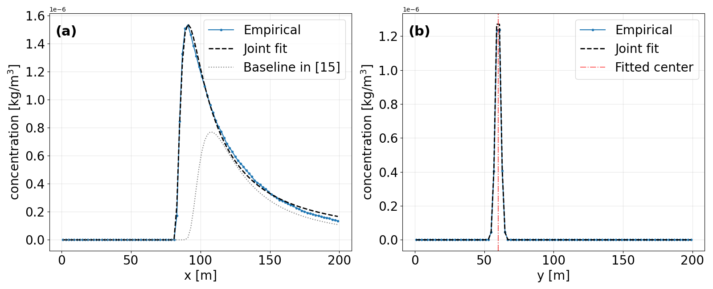
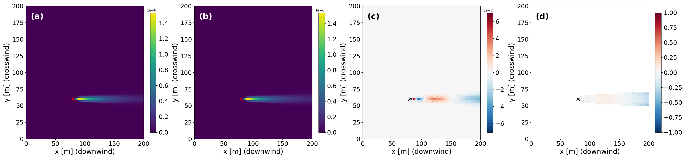
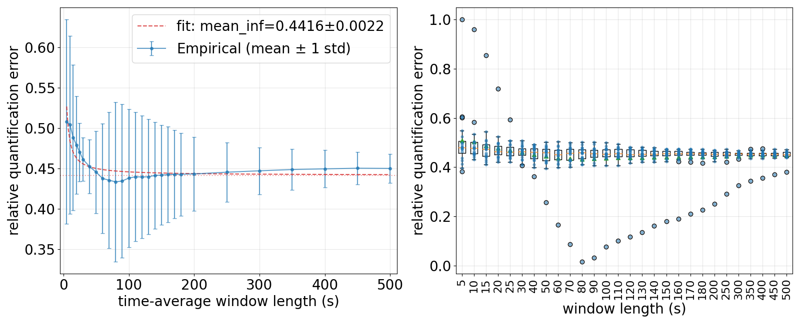
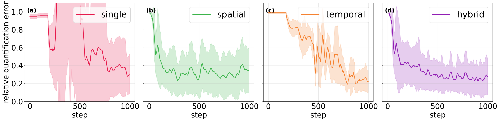

# Spatial-Temporal Hybrid Path Planning for Multi-UAV Methane Emission Rate Quantification

This repository contains the code for generating MOABS simulation data, calibrating the Gaussian Process (GP) model, and running the hybrid path planning algorithm.

## Overview

Running this repository takes two stages:

1. **Generate and process data** (MATLAB)
2. **Configure data paths and run the planning pipeline** (Python)

## Requirements

- **MATLAB**: R2021b (data generation and processing)
- **Python**: 3.10
- **OS**: Ubuntu 22.04 (tested)
- **ffmpeg** (only for exporting `.mp4` in the visualization step): `sudo apt install ffmpeg`

Install the Python dependencies with:

```bash
pip install -r requirements.txt
```

---

## 1. Data Generation and Processing

### 1.1 Data Generation

Data generation is done in MATLAB. Run the following scripts in order:

1. `example1_settings_revised.m`: generates the simulation settings.
2. `example1_revised.m`: runs the MOABS data generation simulation and produces the **raw data**.
   > ⏱ This step may take **3–4 days** on an Intel(R) Core(TM) i9-14900KF CPU under Ubuntu 22.04.
3. `data_save_new.m`: saves the raw data to disk.
   > 💾 Approximately **62 GB** of free storage is required.

### 1.2 Data Processing

Run `time_average_MOABS_Fixed_window.m` to apply fixed-window time averaging. This produces the **input data required by the hybrid planning step**.

---

## 2. Configuration and Planning

### 2.1 GP Model Joint Fit

1. Set `RAW_DATA_DIR` in `global_time_avg_MOABS_GP_joint_fit.py` to your data path, then run the script to jointly fit the GP model.
2. The script outputs calibration checks, residual analysis, and a window-length study, as shown below:





3. Copy the calibrated GP parameters into the function `getModelOutput` in `ParticleClass.py`.

### 2.2 Hybrid Planning

Run `hybrid_planning.py` to execute the proposed hybrid path planning algorithm and compare it with baseline strategies. The expected comparison result is shown below:



### 2.3 Comparison Visualization

Run `single_vs_hybrid_visualization.py` to visualize the single-strategy vs. hybrid-strategy planning process. It generates a `.gif` and an `.mp4` video, for example:


The example of gif and mp4 file can be found in path `cuas/Figures`.